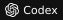
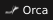

  

## My Sites

  
  
  

<!-- Add the Portfolio link when https://mingon.dev/ is published. -->

## AI

  
  
  
  

  
  
  

## Development

  
  
  
  
  
  
  
  

  
  
  

  
  
  
  
  
  
  

## Security

  
  
  
  
  

## Activity

  

